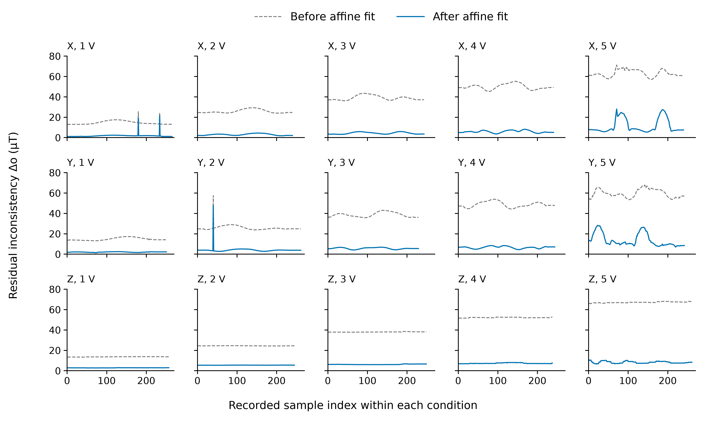

# Affine calibration of the QMC6309 magnetometer array

This package documents the affine calibration method and residual inconsistency results in Sec. III-C of the manuscript. The 15 recorded datasets and required configurations are preserved under `data/` and `config/`. Their SHA-256 hashes are listed in `source_manifest.json`.

## Model and processing order

For sensor $i$, the measurement used for fitting is

$$
\mathbf b^{\mathrm{aligned}}_{i,k}=R_{\mathrm{CORR},i}\mathbf b^{\mathrm{raw}}_{i,k},
\qquad
\mathbf b^{\mathrm{cal}}_{i,k}=D_i\mathbf b^{\mathrm{aligned}}_{i,k}+\mathbf e_i.
$$

`R_CORR` accounts for the known sensor mounting directions. Apply it once. Each $D_i$ is a full $3\times3$ matrix, and each $\mathbf e_i$ contains three offsets. The matrices act on column vectors. The stored `R_CORR` arrays use column-major order. In contrast, each stored `D_i` is already a nested list of matrix rows.

The captured measurements and offsets use gauss (G). The matrices are dimensionless. The conversions are $1\,\mathrm{G}=0.1\,\mathrm{mT}=100\,\mu\mathrm T$.

## Recorded data

The data are in `data/manual_{x,y,z}/manual_record_{1,...,5}V.csv`. Each row contains 36 values, ordered as `sensor_1_x, sensor_1_y, sensor_1_z, ..., sensor_12_z`. There are 3706 rows across 15 files. The files contain no timestamps or robot poses.

The manuscript describes an array at the center of a 3D Helmholtz coil system, rotated about its fixed local Z axis while the X, Y, and Z coils were excited separately. The filename identifies the excitation voltage, from 1 to 5 V. The nominal field settings in the manuscript are 0.5 to 2.5 mT. The executable fit does not use these nominal magnitudes as external calibration targets.

Each CSV row contains one stored array measurement. The CSV files do not record timestamps, rotation angles, averaging settings, or sampling rate.

## Reference field and fit

The sensor positions are stored in `config/sensor_array_params.json`. Let $P$ contain these position vectors as rows. The center-field estimator constructs a basis $Q$ for $\operatorname{null}(P^\top)$ and computes

$$
\mathbf w=\frac{QQ^\top\mathbf 1}{\mathbf 1^\top QQ^\top\mathbf 1},
\qquad
\mathbf b^{\mathrm{ref}}_k=\sum_iw_i\mathbf b^{\mathrm{aligned}}_{i,k}.
$$

For this symmetric 12-sensor geometry, the weights are all $1/12$ to numerical precision. For each file separately, the code keeps the reference direction and sets its magnitude to the mean reference magnitude in that file:

$$
\mathbf t_k=\mathbf b^{\mathrm{ref}}_k
\frac{\operatorname{mean}_{j\ \mathrm{in\ file}}\|\mathbf b^{\mathrm{ref}}_j\|_2}
{\|\mathbf b^{\mathrm{ref}}_k\|_2}.
$$

All 15 files are then concatenated. Each sensor is fitted independently by minimizing $\sum_k\|D_i\mathbf b^{\mathrm{aligned}}_{i,k}+\mathbf e_i-\mathbf t_k\|_2^2$. The reproduction script solves the augmented linear least-squares problem with `numpy.linalg.lstsq`. Every sensor has an augmented design matrix of rank four for this dataset.

This procedure fits consistency against a reference constructed from the array measurements. It does not establish absolute field accuracy against an independent reference instrument.

## Reproduce the results

Python 3 and NumPy are sufficient. Run from this directory:

```bash
python3 -m pip install -r requirements.txt
python3 reproduce_calibration.py
```

The reproduction was checked with NumPy 2.3.5. The script verifies the snapshot hashes before fitting and writes its outputs to `results/`. An alternative output directory can be selected with `--output`.

- `affine_model_params_refit.json`: the fitted $D_i$ and $\mathbf e_i$ for sensors 1–12.
- `per_condition.csv`: sample counts, measured reference magnitudes, and residual statistics for all 15 files.
- `per_sample.csv`: the residual inconsistency before and after fitting for every recorded row, with coil, voltage, and sample index.
- `summary.json`: aggregate statistics, fit ranks, and differences from the saved experimental parameters.

To regenerate the residual curves, install the optional plotting dependencies and run:

```bash
python3 -m pip install -r requirements-plot.txt
python3 plot_residuals.py
```

This creates `results/residual_consistency.pdf`, `.svg`, and `.png` from `per_sample.csv`. To use a different fit output directory, pass the same directory to `reproduce_calibration.py --output DIRECTORY` and `plot_residuals.py --results DIRECTORY`.

The portable calculation was also checked against the functions in the retrieved original script. The largest difference in $D_i$ was below $4.5\times10^{-15}$ and the largest difference in $\mathbf e_i$ was below $6.0\times10^{-15}$ G. See `reference_results/original_code_equivalence.json`. The refitted parameters also agree with the saved `affine_model_params.json` to numerical precision: maximum absolute differences are below $3.5\times10^{-15}$ in $D_i$ and $1.1\times10^{-14}$ G in $\mathbf e_i$.

## Residual inter-sensor inconsistency

For each row, the metric is the centered vector RMS across the 12 sensors:

$$
\Delta o_k=\sqrt{\frac1{12}\sum_{i=1}^{12}
\left\|\mathbf b_{i,k}-\frac1{12}\sum_{j=1}^{12}\mathbf b_{j,k}\right\|_2^2}.
$$

Before calibration, $\mathbf b_{i,k}$ denotes the readings after `R_CORR`. After calibration, it denotes the affine-corrected readings. Subtracting a common reference from every sensor leaves this centered metric unchanged. Consequently, evaluating this metric against the normalized or unnormalized common reference gives the same value.

The table reports the mean of $\Delta o_k$ within each file. The reference magnitude column is the measured array-derived mean used by the fit.



**Residual curves.** Rows correspond to X-, Y-, and Z-coil excitation and columns to 1–5 V. Each point is the centered vector RMS across 12 sensors in one saved row. The gray dashed and blue solid curves show readings after mounting alignment and after the affine correction, respectively. All 3706 recorded rows are shown, in file order, without smoothing or exclusions. The horizontal axis is a sample index because the CSV files contain no timestamps or rotation angles. These curves evaluate the same data used for fitting. Per-condition sample counts are listed below.

| Coil | Voltage (V) | Rows | Mean reference (mT) | Before (μT) | After (μT) |
|---|---:|---:|---:|---:|---:|
| X | 1 | 265 | 0.4915 | 14.60 | 1.75 |
| X | 2 | 240 | 0.9842 | 25.68 | 2.88 |
| X | 3 | 243 | 1.4862 | 38.96 | 4.29 |
| X | 4 | 241 | 1.9672 | 49.83 | 5.75 |
| X | 5 | 240 | 2.4440 | 63.03 | 11.35 |
| Y | 1 | 251 | 0.5026 | 14.75 | 2.00 |
| Y | 2 | 261 | 0.9996 | 25.71 | 3.98 |
| Y | 3 | 229 | 1.4876 | 38.61 | 5.59 |
| Y | 4 | 244 | 1.9615 | 48.62 | 6.54 |
| Y | 5 | 242 | 2.4452 | 59.58 | 13.52 |
| Z | 1 | 257 | 0.4606 | 13.58 | 2.79 |
| Z | 2 | 245 | 0.9505 | 24.38 | 5.39 |
| Z | 3 | 249 | 1.4503 | 37.97 | 6.15 |
| Z | 4 | 238 | 1.8985 | 52.11 | 7.24 |
| Z | 5 | 261 | 2.2918 | 67.06 | 8.20 |

Giving equal weight to the 15 condition means produces $38.30\pm18.05\,\mu\mathrm T$ before calibration and $5.83\pm3.31\,\mu\mathrm T$ after calibration. Here ± is the sample standard deviation of the 15 condition means (`ddof=1`). The reduction in their mean is 84.78%.

Pooling all 3706 rows instead produces $38.04\pm17.72\,\mu\mathrm T$ and $5.78\pm4.11\,\mu\mathrm T$, where ± is the population standard deviation across rows (`ddof=0`). These are different aggregation conventions. The values above describe residual consistency on the data used for fitting. There is no held-out dataset in this procedure.

## Files

`data/` contains the original CSV bytes. `config/` contains the sensor geometry, mounting rotations, and saved affine parameters. `reference_results/` preserves the numerical and graphical outputs used by this README. New calculations go to `results/`.
